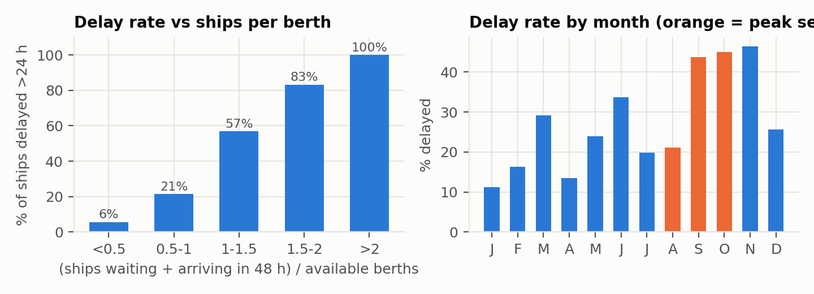
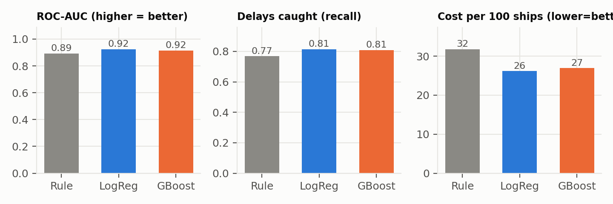
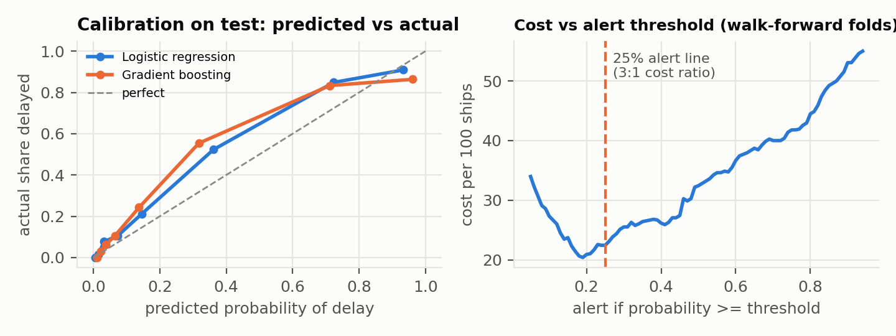
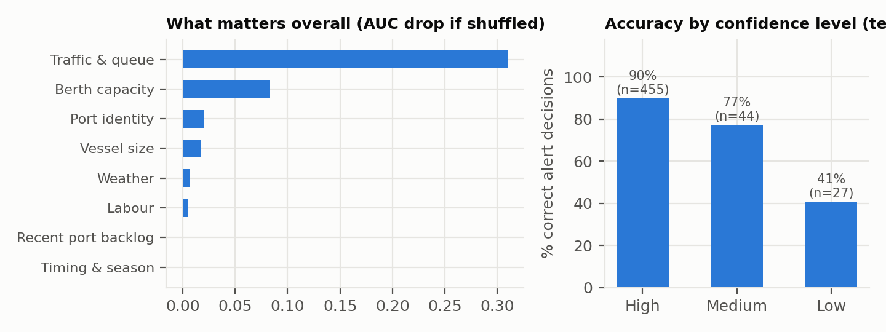

# Port Congestion & Shipment Delay Predictor

Predicts, **48 hours before a ship arrives**, whether it will be stuck waiting at anchorage for more
than **24 hours** before getting a berth. For every port call it returns:

1. **Probability** of a delay (e.g. 75%)
2. **Confidence**: how stable that answer is (High / Medium / Low)
3. **Reasons** in plain English ("6 ships due for 4 berths; storm forecast with ~23 h of closure")
4. **A recommended action** (warn the customer, slow-steam, re-book trucks, or do nothing)

> Built for the Aiqon Jr AI Engineer take-home. Data is **synthetic** (a simulation of 4 fictional ports),
> and the simulation is described in full below so the results can be judged fairly.

**Live demo:** <add your Streamlit link here> · **Report:** [report/Report.pdf](report/Report.pdf)

---

## Results at a glance

Test period: **May–Oct 2026** (monsoon + peak season, 526 port calls, 34% delayed), never used for training or model choice.

| Approach | ROC-AUC | Delays caught (recall) | Precision | Cost per 100 ships* |
|---|---|---|---|---|
| Never alert | 0.50 | 0% | – | 101 |
| Always alert | 0.50 | 100% | 34% | 66 |
| Rule a port planner might use | 0.89 | 77% | 76% | 32 |
| **Logistic regression (chosen)** | **0.92** | **81%** | **79%** | **26** |
| Gradient boosting | 0.92 | 81% | 78% | 27 |

\*Cost = 3 × missed delays + 1 × false alarms, per 100 ships (a missed delay is assumed 3× as costly as a false alarm).

- The model cuts the cost of wrong calls by **17%** compared with the planner's rule.
- **The confidence score works:** High-confidence predictions are right 90% of the time, Medium 77%, Low 41% (≈ a coin flip, so the system correctly says "don't trust this one").
- **Traffic per berth is the main driver.** Weather and strikes are rare but decisive when they happen. Explanations are per ship, so a storm-hit ship gets "weather" as a top reason even though weather ranks low on average.

---

## Quick start

```bash
git clone <this repo url> && cd port-congestion-predictor
python -m venv .venv && source .venv/bin/activate      # Windows: .venv\Scripts\activate
pip install -r requirements.txt

python -m src.simulate          # 1. generate data/port_calls.csv            (~3 s)
python -m src.train             # 2. train + evaluate, save model & figures  (~10 s)
python -m src.predict --examples   # 3. explain 4 real test cases in the terminal
streamlit run app.py            # 4. interactive demo in the browser
python -m report.build_report --repo-url <your repo url>   # 5. rebuild report/Report.pdf
python -m pytest -q             # 6. run the 11 automated checks
```

Shortcut: `streamlit run app.py` on a fresh clone builds the data and model by itself on first launch (~15 s).

Ask about your own scenario from the terminal:

```bash
python -m src.predict --port Eastgate --waiting 4 --arriving 3 --wind 70 --storm-hours 20
```

All settings (delay threshold, cost ratio, dates, port profiles) live in `src/config.py`.

---

## 1. What "congestion" means here

A port call is **delayed** if the ship waits **more than 24 hours at anchorage** before it gets a berth.

- **Why waiting time, not total turnaround?** Turnaround also includes unloading time, which depends on how much cargo the ship carries, not on congestion. Waiting time is the part caused by the port being busy.
- **Why 24 h?** It is a common operational line: beyond a day, delivery dates, truck bookings and onward connections start to break. It's one setting in `config.py`.
- **Why predict 48 h ahead?** That is early enough to act (slow down, warn the customer, re-plan trucks) and late enough that the port situation is reasonably known.

## 2. Data: a simulation, not random numbers

If the label were written as a formula of the features (e.g. `delay = 3*queue + 2*storm`), any model
would just rediscover the formula and prove nothing. Instead, `src/simulate.py` **simulates how a port
works, hour by hour**, and the waiting time comes out of that process:

```
ship arrives -> joins anchorage queue (first come, first served)
            -> gets a berth when one is free, the port is open, and (at some ports) it's daylight
            -> is unloaded (slower in rough weather, paused in storms/strikes) -> leaves
```

**4 fictional ports** with different profiles (variability across ports):

| Port | Berths (deep) | Profile | Delay rate |
|---|---|---|---|
| Northbay | 4 (2) | big, efficient hub, heavy traffic | 22% |
| Eastgate | 3 (1) | monsoon-exposed, frequent storm closures | 38% |
| Southreach | 2 (0) | small, slow, frequent strikes, **daylight-only berthing** | 31% |
| Westhaven | 2 (1) | quiet regional port | 23% |

**What drives delays in the simulation** (all assumptions, stated openly):
- **Arrivals:** random (Poisson) with seasonality (Aug–Oct peak, Feb lull), weekday pattern, and **"waves"**, a slowly drifting factor that bunches ships together, as happens after upstream disruptions.
- **Service time:** grows with ship size (TEU), port productivity and random variation.
- **Weather:** hourly wind with more storms in monsoon (Jun–Sep) and cyclone season (Oct–Nov). Port **stops above 45 km/h**; cranes work at **half speed between 35–45 km/h**.
- **Strikes:** 12–72 h; **70% announced in advance, 30% sudden** (unpredictable by design).
- **Maintenance:** a berth out for 3–10 days, planned (known in advance).
- **Deep-water berths:** ships over 8,000 TEU can only use them.

**Real-world data problems injected on purpose:** weather forecast missing 8%, incoming-traffic (AIS)
data missing 5–6%, vessel size missing 3%; ship ETAs off by ~8 h; a 2-day wind forecast off by ~7 km/h.

**Result:** 2,064 port calls over 24 months (Nov 2024 – Oct 2026), 28.5% delayed. The assignment suggests
100–500 rows; more were generated because a queue needs realistic traffic to produce congestion. The
learning curve (below) shows ~500 rows already gets within 0.01 AUC of the full result.

### Columns (`data/port_calls.csv`)

| Known 48 h before arrival (model inputs) | Known only afterwards (never used as inputs) |
|---|---|
| `ships_waiting_now`, `berths_busy_now`, `expected_arrivals_48h` (from ETAs), `berths_available`, `forecast_max_wind_kmh`, `forecast_storm_hours`, `strike_notice`, `vessel_teu`, `needs_deep_berth`, `recent_avg_wait_7d_h`, `arrival_hour`, `day_of_week`, `month`, `port` | `wait_hours`, `delayed` (label), `turnaround_hours`, `storm_hours_while_waiting`, `strike_hours_while_waiting` (used only for error analysis) |

## 3. Features (`src/features.py`)

Rule: **a feature may only use information available 48 h before arrival** (no peeking at the answer).

| Group | Features | Why |
|---|---|---|
| Traffic & queue | ships waiting, ships due in 48 h, **ships per available berth**, berth occupancy | The core congestion signal is the *interaction* of traffic and capacity |
| Berth capacity | berths available, maintenance flag | Fewer berths, same traffic → queue |
| Weather | forecast max wind, **forecast hours of closure**, storm × ships-per-berth | Duration matters more than peak; a storm hurts more when the port is already busy |
| Labour | strike announced | Stops all work |
| Vessel | size, needs deep-water berth | Big ships compete for fewer berths |
| Timing | peak season, night arrival, **night arrival at a daylight-only port**, weekend | Temporal patterns |
| Recent backlog | average wait at this port over the last 7 days | Momentum |
| Port | one-hot port identity | Port-specific baseline |

## 4. Models and evaluation (`src/train.py`)

- **Three approaches:** a hand-written planner's rule (baseline to beat), logistic regression, gradient boosting.
- **Time-based split, never random.** Development = Nov 2024 – Apr 2026; **test = May – Oct 2026**, the hardest season (monsoon + peak), touched once at the end. A ship only enters training once its outcome is known.
- **Walk-forward validation** inside development: 3 folds (Aug–Oct 2025, Nov 2025–Jan 2026, Feb–Apr 2026), each trained only on the past. Logistic regression won on average (AUC 0.944 vs 0.913 for gradient boosting and 0.914 for the rule; Brier 0.085 vs 0.099).
- **Why the simpler model won:** the key interactions (ships per berth, storm × traffic) are engineered as features, so a linear model can use them; with ~1,500 rows, gradient boosting overfits slightly. Simpler is also easier to explain and maintain.
- **Alert threshold = 25%**, from decision theory, not tuning: with a 3:1 cost ratio, alerting is worth it when `P × 3 > (1 − P) × 1`, i.e. `P > 1/(1+3)`. The cost curve on validation is flat around it (best 0.19 → 20.4 vs 22.4 per 100 ships at 0.25), so the principled value was kept.
- **Metrics:** ROC-AUC and PR-AUC (ranking), recall/precision/F1 at the alert line, **Brier score and calibration** (is "70%" really 70%?), **cost per 100 ships** (the business view), per-port breakdown, and error analysis.

## 5. Confidence score

**Confidence = share of 25 model versions that reach the same alert decision.** Each version is trained on a
different random resample of the history (bootstrap) and fills any missing input with a different
plausible value from that port's history. One simple number captures three sources of doubt:
the model is unsure (little similar history), the probability sits near the alert line, or
key data is missing. A penalty is added when traffic is beyond almost anything seen in training.

Probability and confidence answer different questions: **probability = "how likely is the delay?"**,
**confidence = "how stable is that answer?"**

| Confidence | Share of test cases | Alert decision correct |
|---|---|---|
| High (≥ 23/25 agree) | 87% | 90% |
| Medium (18–22/25) | 8% | 77% |
| Low (< 18/25) | 5% | 41% |

## 6. Explanations and actions (`src/predictor.py`)

- **"What if this factor were normal?"** For each factor group, reset it to a typical day *at this port* and re-predict. *"Traffic: 6 ships due for 4 berths → raises risk by 45 pts (if normal: 29%)"*. Works with any model, and every number can be said out loud and checked.
- **Hours estimate:** past ships at the same port with a similar predicted risk, and how long they *actually* waited (median and typical range).
- **Action** depends on risk level (Low < 25% ≤ Elevated < 60% ≤ High) and on the main driver: traffic → slow-steam to arrive just in time / consider an alternative port; weather → expect a short slip, don't re-route; strike → line up a backup; maintenance → ask for a post-maintenance berth window.

## 7. Results






**Per port (test):** ROC-AUC 0.88 (Northbay) to 0.95 (Southreach). Northbay has the lowest recall (64%)
because delays there are rare in the test period (12%) and mostly caused by short traffic waves.

**Error analysis (33 missed delays of 177):** 16 were borderline (waited 24–36 h), 13 came from queues
building faster than the ETAs suggested, 3 from storms the forecast missed, 1 from missing AIS data.

## 8. Limitations (read before trusting the numbers)

- **Synthetic data.** The model can only learn what the simulator contains. Real ports have more causes
  (customs, yard congestion, crane breakdowns, priority berthing for liner contracts). The numbers show the *method works*, not how well it would do at a real port.
- **Seasonal drift.** On the test period (monsoon + peak), the model **underestimates mid-range risk**: ships rated ~35% were delayed ~52% of the time. In production: recalibrate monthly and monitor calibration per season.
- **What-if explanations are one-factor-at-a-time.** When two factors together push risk to ~100%, removing one barely changes it, so the second may look unimportant (saturation). SHAP values would split credit more fairly (not used, to keep dependencies minimal).
- **The 3:1 cost ratio is an assumption.** It should come from the business; the threshold updates automatically.
- **Independent ports.** Real ports interact (ships divert from a congested port to a neighbour).

## 9. Next steps with real data

1. **AIS (MarineCadastre / commercial feeds):** detect port calls by finding ships that stop inside an anchorage polygon (speed < 1 knot) and later move to a berth polygon; waiting time = berth entry − anchorage entry. Queue length and arrivals-in-48h come from the same feed.
2. Add weather (e.g. ERA5 / NOAA forecasts) and port notices (strikes, maintenance).
3. Keep the same pipeline: features → walk-forward validation → calibrated probability → confidence → explanation.

## Automated checks (`tests/test_pipeline.py`)

`python -m pytest -q` runs 11 checks on the rules the results depend on. The label must match the
24 h definition. Scrambling every outcome column must leave every model input unchanged (no leakage).
No training answer may come from the test period or after a validation fold starts. The alert line must
follow the cost ratio. Predictions must be valid probabilities. And the model must behave sensibly:
more ships waiting must mean more risk, and missing data must be reported.

## Project structure

```
port-congestion-predictor/
├── app.py                  # Streamlit demo (what-if planner + replay real test cases)
├── requirements.txt
├── src/
│   ├── config.py           # every setting in one place (threshold, costs, ports, dates)
│   ├── simulate.py         # hour-by-hour port simulation -> data/port_calls.csv
│   ├── features.py         # feature engineering + time-based splits
│   ├── train.py            # model comparison, evaluation, figures, saves model bundle
│   ├── predictor.py        # probability, confidence, explanations, actions
│   └── predict.py          # command-line interface
├── tests/test_pipeline.py  # 11 checks: label, no leakage, time split, sensible behaviour
├── data/port_calls.csv     # generated dataset (2,064 port calls)
├── models/                 # created by train.py
├── outputs/                # metrics.json, figures, test_predictions.csv, train_log.txt
└── report/
    ├── Report.pdf          # 3-page technical report
    └── build_report.py     # builds the PDF from outputs/metrics.json (numbers can't drift)
```

Numbers above come from `outputs/metrics.json` (seed 42). Other scikit-learn versions may shift them slightly.
